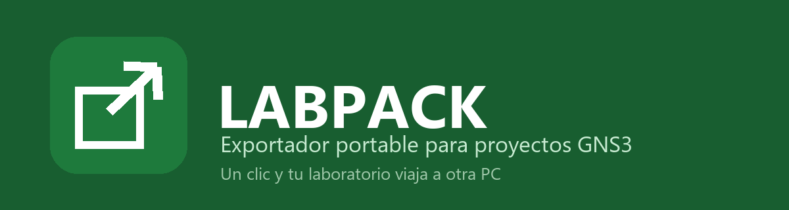

<div align="center">




</div>

El exportador oficial de GNS3 falla cuando el proyecto tiene nodos VMware.
Esta herramienta arma el paquete a mano con el mismo formato estándar:
un ZIP con `project.gns3` + `README.txt` + `project-files/`.

<div align="center">


</div>

## Uso

```
1. Code → Download ZIP → descomprime la carpeta
2. 0-Preparar-Antivirus.bat  (una sola vez — excluye la carpeta de Defender)
3. LabPack.bat               (doble clic → abre la ventana)
4. Elige la carpeta de tu proyecto y el destino → EXPORTAR AHORA
```

Sale `TuProyecto.gns3project` listo para importar con
`File → Open portable project`.

**¿Dónde está mi proyecto?** GNS3 los guarda normalmente en
`C:\Users\TU-USUARIO\GNS3\projects\NombreDelProyecto`.

## Avisos antes de usar

- **SmartScreen (pantalla azul)**: al abrir un .bat descargado Windows
  puede decir "protegió tu PC". Es normal con herramientas sin firma
  digital → clic en "Más información → Ejecutar de todas formas".
- **0-Preparar-Antivirus.bat pide administrador**: agrega la carpeta a las
  exclusiones de Windows Defender. Si no tienes admin, salta este paso —
  el exportador funciona igual mientras tu antivirus no lo bloquee. Solo
  cubre Defender; con Avast/McAfee agrega la carpeta a sus exclusiones.
- **Imágenes IOS**: para que el proyecto *corra* en la otra PC hacen
  falta las mismas imágenes (ej. Cisco 3725). El archivo importa igual
  y GNS3 te dice exactamente cuál falta.

## Qué empaca y qué no

| Incluye | No incluye |
|---|---|
| `project.gns3` (topología) | `project-files\vmware\` |
| `README.txt` | `project-files\virtualbox\` |
| `dynamips\` (configs) | `project-files\docker\` |
| `images\`, `captures\` (pcap) | |
| Todo lo demás de `project-files\` | |

Los discos de VMs dependen de la PC local: no son portables ni siquiera
para el exportador oficial.

## Estructura

```
├── 0-Preparar-Antivirus.bat   paso 0: exclusion de Defender
├── LabPack.bat                lanzador → abre la ventana
├── README.md · LICENSE · CHANGELOG · CONTRIBUTING · CODE_OF_CONDUCT · SECURITY
└── APP/                   dividida por dominios
    ├── Core/      LabPack.Core.ps1 — dominio puro del empaquetado (una sola vez)
    ├── Interfaz/  LabPack.UI.ps1/.bat — adaptador WinForms → llama al Core
    ├── Consola/   LabPack.CLI.ps1/.bat — adaptador CLI → llama al Core
    ├── Recursos/  labpack.ico, logo, banner, captura
    └── Docs/      GUIA.md
```

La lógica vive solo en `Core/`; la ventana y la consola son adaptadores
que lo consumen — no hay código duplicado entre interfaces.

## Autor

**Luis Martin Peña Mejia** — Fundador y CTO de **MKZ COMPANY** 🇩🇴
Estudiante de Ingeniería de Software, UCE Punta Cana · Matrícula 2023-4341
[@luismartin023](https://github.com/luismartin023) · República Dominicana

> LabPack es un desarrollo de **MKZ COMPANY** nacido de un problema real
> de clase: el exportador oficial de GNS3 se rinde con nodos VMware.
> Esta herramienta empaqueta lo que el oficial no puede.

## Licencia y aviso legal

Software libre bajo **licencia MIT** — ver [LICENSE](LICENSE). Puedes
usarlo, copiarlo y modificarlo libremente.

LabPack **no está afiliado ni respaldado por GNS3 Technologies**; "GNS3"
es marca de sus respectivos propietarios. Esta herramienta solo genera
un archivo en el formato estándar `.gns3project`.
