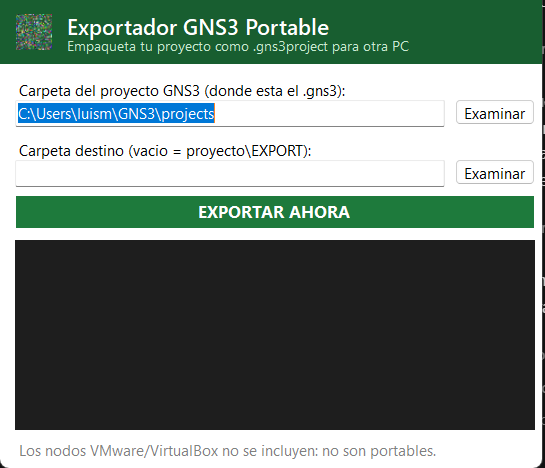

<div align="center">

# Exportador GNS3 Portable

**Empaqueta cualquier proyecto de GNS3 como `.gns3project` y llévalo a otra PC.**


</div>

El exportador oficial de GNS3 falla cuando el proyecto tiene nodos VMware.
Esta herramienta arma el paquete a mano con el mismo formato estándar:
un ZIP con `project.gns3` + `README.txt` + `project-files/`.

<div align="center">



</div>

## Uso

```
1. Code → Download ZIP → descomprime la carpeta
2. 0_ANTIVIRUS.bat        (una sola vez — excluye la carpeta de Defender)
3. Exportador GNS3.bat    (doble clic → abre la ventana)
4. Elige la carpeta de tu proyecto y el destino → EXPORTAR AHORA
```

Sale `TuProyecto.gns3project` listo para importar con
`File → Open portable project`.

**¿Dónde está mi proyecto?** GNS3 los guarda normalmente en
`C:\Users\TU-USUARIO\GNS3\projects\NombreDelProyecto`.

## Avisos antes de usar

- **SmartScreen (pantalla azul)**: al abrir un .bat descargado Windows
  puede decir "protegió tu PC". Es normal con herramientas sin firma
  digital → clic en "Más información → Ejecutar de todas formas".
- **0_ANTIVIRUS.bat pide administrador**: agrega la carpeta a las
  exclusiones de Windows Defender. Si no tienes admin, salta este paso —
  el exportador funciona igual mientras tu antivirus no lo bloquee. Solo
  cubre Defender; con Avast/McAfee agrega la carpeta a sus exclusiones.
- **Imágenes IOS**: para que el proyecto *corra* en la otra PC hacen
  falta las mismas imágenes (ej. Cisco 3725). El archivo importa igual
  y GNS3 te dice exactamente cuál falta.

## Qué empaca y qué no

| Incluye | No incluye |
|---|---|
| `project.gns3` (topología) | `project-files\vmware\` |
| `README.txt` | `project-files\virtualbox\` |
| `dynamips\` (configs) | `project-files\docker\` |
| `images\`, `captures\` (pcap) | |
| Todo lo demás de `project-files\` | |

Los discos de VMs dependen de la PC local: no son portables ni siquiera
para el exportador oficial.

## Estructura

```
├── 0_ANTIVIRUS.bat        paso 0: exclusion de Defender
├── Exportador GNS3.bat    lanzador → abre la ventana
└── APP/                   scripts, icono, captura, GUIA.md
```

## Autor

Luis Martin Peña Mejia · 2023-4341 · UCE Punta Cana
